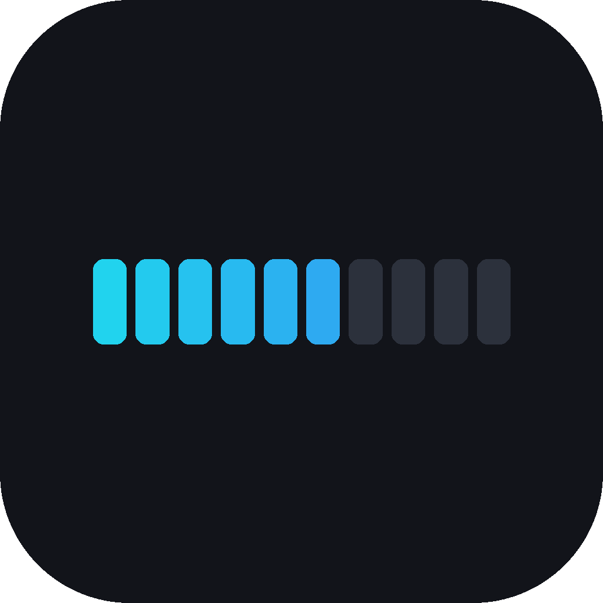
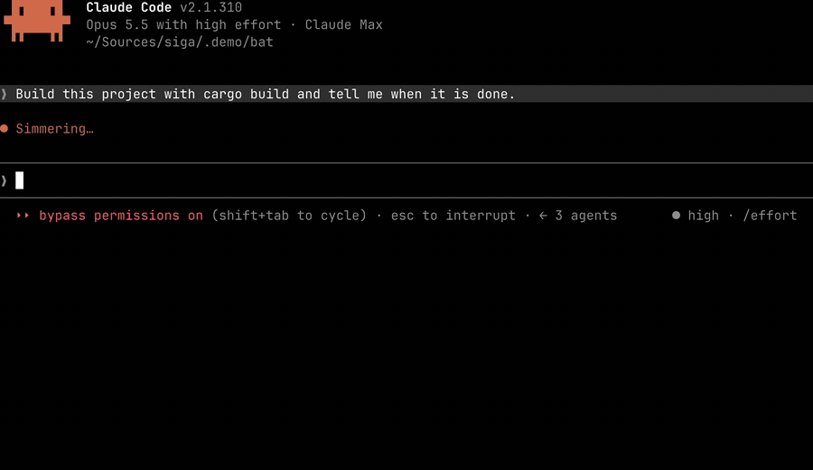

<p align="center"></p>

<h1 align="center">siga</h1>

<p align="center"><b>Progress bars that keep filling after they are printed.</b><br>
<i>Siga-siga</i> means "slowly-slowly" in Cyprus. Your build can take its time; the bar keeps up.</p>

| Claude Code today | With siga |
|---|---|
| <a href="docs/media/before.mp4"></a> | <a href="docs/media/after.mp4"></a> |
| Every wait prints another progress line. | One bar, written once, fills in place. |

Claude writes `⟦bar⟧` once, in the message that starts a long job. siga turns it into a
live bar and keeps it moving while the job runs, inside text that was already printed.
Ghostty draws it with a shader, Kitty with an image placeholder.

## Install

In Claude Code 2.1.275+:

```
/plugin install siga --marketplace souvlakeee/siga
/siga:setup
```

`/siga:setup` lists its changes (a font, a shader, a marked Ghostty config block, all
backed up) and asks first. Kitty needs nothing. Python 3.9+, standard library only.

Works in **Ghostty 1.3+** and **Kitty 0.49+**. Other terminals get a static `▰▰▰▱▱▱` bar.

## Progress sources

Build-like commands (npm, cargo, go, make, docker build, pytest, pip, uv, curl -o, wget,
rsync, git clone, ffmpeg, yt-dlp, …) are wrapped automatically; output and exit codes pass
through unchanged. Add patterns in `~/.config/siga/wrap.txt`. For anything else:

| Your command… | Use |
|---|---|
| prints `12/40` or `45%` | `siga run -- ./build.sh` |
| draws its bar only on a terminal | `siga run --pty -- cargo build` |
| uses tqdm, rich, click, cli-progress | `siga run --shim -- python train.py` |
| prints named steps | `siga run --step '^==> ' -- ./deploy.sh` |
| prints nothing useful | `siga run -- make` (learns the duration) |
| is your own script | `siga set 3/10`, then `siga done` / `siga fail` |
| must stay in a pipe | `set -o pipefail; tool 2>&1 \| siga pipe; siga end $?` |

<details>
<summary>30 tested examples: shell tools, build tools, Python, Node, Go, Rust, OSC 9;4</summary>

<!-- examples:start -->
| Family | Tool | Command | Example |
|---|---|---|---|
| Shell tools | curl | `siga run -- curl --limit-rate 8M -o big.bin "$URL"` | [curl.sh](examples/shell/curl.sh) |
| Shell tools | curl -# | `siga run -- curl -# --limit-rate 8M -o big.bin "$URL"` | [curl_bar.sh](examples/shell/curl_bar.sh) |
| Shell tools | ffmpeg | `siga run -- ffmpeg -y -re -i in.mp4 -c:v libx264 -preset ultrafast out.mp4` | [ffmpeg.sh](examples/shell/ffmpeg.sh) |
| Shell tools | git clone | `siga run -- git clone --progress "file://$WORK/origin.git" copy` | [git.sh](examples/shell/git.sh) |
| Shell tools | any command, piped | `build 2>&1 \| siga pipe; siga end $?` | [pipe_anything.sh](examples/shell/pipe_anything.sh) |
| Shell tools | a failing piped command ends red, with its own exit code | `build 2>&1 \| siga pipe; siga end $?` | [pipe_fail.sh](examples/shell/pipe_fail.sh) |
| Shell tools | pv | `siga run -- sh -c 'pv -f -i 0.5 -L 8m f1.bin > copy.bin'` | [pv.sh](examples/shell/pv.sh) |
| Shell tools | rsync | `siga run -- rsync -a --info=progress2 --bwlimit=8m src/ dst/` | [rsync.sh](examples/shell/rsync.sh) |
| Shell tools | a custom script with named steps | `siga run --step '^==> ' --steps 5 -- ./deploy.sh` | [steps.sh](examples/shell/steps.sh) |
| Shell tools | wget | `siga run -- wget --limit-rate=8m --progress=bar:force -O big.bin "$URL"` | [wget.sh](examples/shell/wget.sh) |
| Shell tools | yt-dlp | `siga run -- yt-dlp --newline --limit-rate 8M -o video.bin "$URL"` | [yt-dlp.sh](examples/shell/yt-dlp.sh) |
| Build tools | cargo build | `siga run --pty -- cargo build` | [cargo.sh](examples/build/cargo.sh) |
| Build tools | docker build | `siga run -- docker build --progress=plain --no-cache -t siga-demo .` | [docker.sh](examples/build/docker.sh) |
| Build tools | make | `siga run -- make` | [make_eta.sh](examples/build/make_eta.sh) |
| Build tools | pytest -v | `siga run -- pytest -v` | [pytest.sh](examples/build/pytest.sh) |
| Python libraries | alive-progress | `siga run --pty -- python alive_demo.py` | [alive.sh](examples/python/alive.sh) |
| Python libraries | click.progressbar | `siga run --pty -- python click_demo.py` | [click.sh](examples/python/click.sh) |
| Python libraries | rich | `siga run --pty -- python rich_demo.py` | [rich.sh](examples/python/rich.sh) |
| Python libraries | rich, exact values via --shim | `siga run --shim -- python rich_demo.py` | [rich_shim.sh](examples/python/rich_shim.sh) |
| Python libraries | tqdm | `siga run -- python tqdm_demo.py` | [tqdm.sh](examples/python/tqdm.sh) |
| Node libraries | cli-progress | `siga run --pty -- node cli_progress_demo.js` | [cli_progress.sh](examples/node/cli_progress.sh) |
| Node libraries | cli-progress, exact values via --shim | `siga run --pty --shim -- node cli_progress_demo.js` | [cli_progress_shim.sh](examples/node/cli_progress_shim.sh) |
| Node libraries | progress | `siga run --pty -- node progress_demo.js` | [progress.sh](examples/node/progress.sh) |
| Go libraries | vbauerster/mpb | `siga run --pty -- ./demo` | [mpb.sh](examples/go/mpb.sh) |
| Go libraries | cheggaaa/pb | `siga run --pty -- ./demo` | [pb.sh](examples/go/pb.sh) |
| Go libraries | schollz/progressbar | `siga run --pty -- ./demo` | [schollz.sh](examples/go/schollz.sh) |
| Rust libraries | indicatif | `siga run --pty -- ./target/debug/indicatif-demo` | [indicatif.sh](examples/rust/indicatif.sh) |
| OSC 9;4 emitters | cargo's own OSC 9;4 | `CARGO_TERM_PROGRESS_TERM_INTEGRATION=true siga run --pty -- cargo build` | [cargo.sh](examples/osc/cargo.sh) |
| OSC 9;4 emitters | OSC 9;4 from Python | `siga run -- python3 job.py` | [python.sh](examples/osc/python.sh) |
| OSC 9;4 emitters | OSC 9;4 from a shell script | `work \| siga pipe; siga end $?` | [shell.sh](examples/osc/shell.sh) |
<!-- examples:end -->

`bin/siga selftest` runs all of them offline.
</details>

Without Claude Code: `git clone https://github.com/souvlakeee/siga && cd siga`, then
`bin/siga setup --apply` and `bin/siga run -- cargo build`.

## How it works

- **Ghostty:** the bar is private-use glyphs in color keys; a shader repaints them from a
  value siga sends as an OSC 4 palette color.
- **Kitty:** the bar is an image placeholder; siga re-uploads the image.
- **Claude Code:** hooks swap `⟦bar⟧` for the glyphs on screen, wrap build commands, and
  teach Claude the one-bar-per-job rule.

Details: [docs/HOW_IT_WORKS.md](docs/HOW_IT_WORKS.md).

## Limitations

- One bar per terminal window; parallel jobs share it.
- Tested on macOS; Linux is untested.
- `siga off` / `siga on` pause the hooks; `siga setup --remove` uninstalls.

## Thanks

[ghostty-blackhole](https://github.com/s0xDk/ghostty-blackhole) (shader input via a color
escape), Kitty's [Unicode placeholders](https://sw.kovidgoyal.net/kitty/graphics-protocol/#unicode-placeholders),
[Fira Code](https://github.com/tonsky/FiraCode) (the first progress glyphs in a font).

## License

MIT
